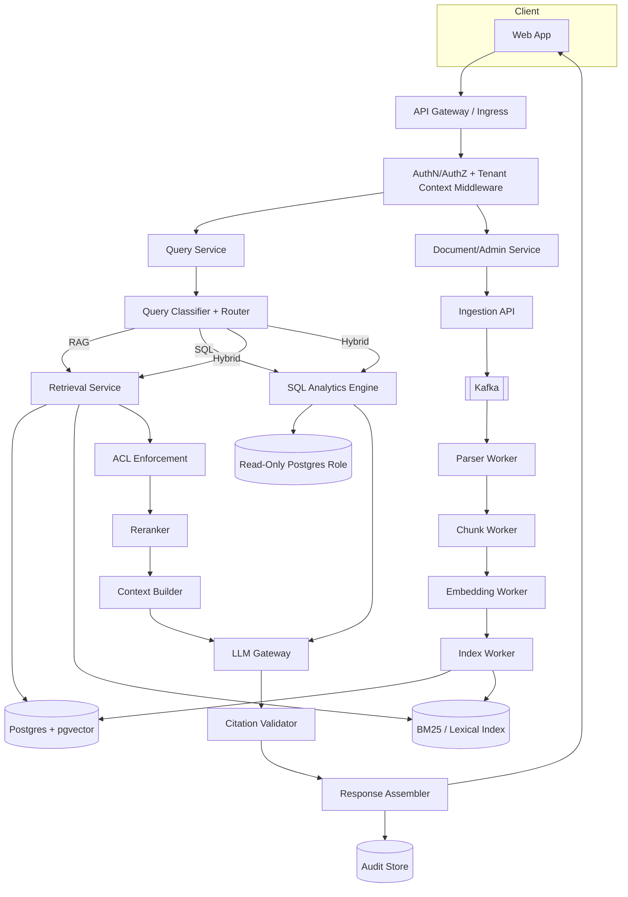
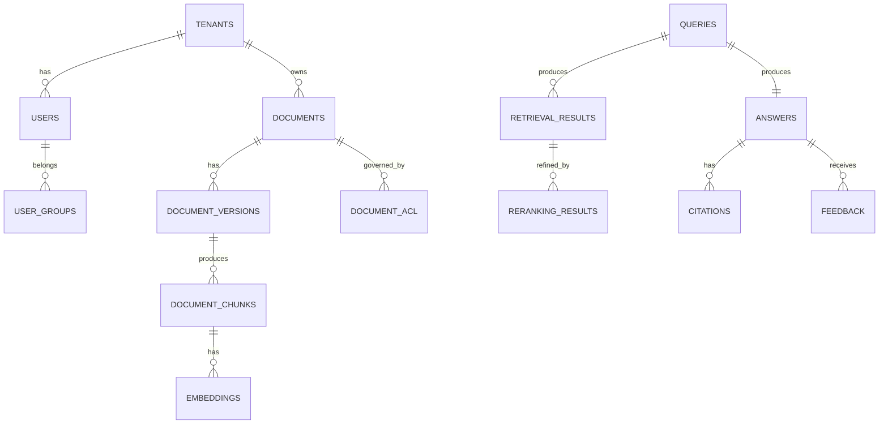

# PHASE 0 — SYSTEM ARCHITECTURE & DESIGN
## Enterprise Knowledge & Support Copilot (Enterprise Knowledge Intelligence Platform)

> Status: **DESIGN ONLY — no implementation code in this document.**
> Scope note (read first): This platform is being developed in a sandboxed, single-container
> environment with no live Kubernetes cluster, no live Kafka broker running persistently, and a
> locked-down network (package registries + GitHub only). Everything below is a genuine,
> implementable architecture. Sections that require live infrastructure to *prove* (load numbers,
> chaos-test results, restored backups, k8s rollouts) are marked `NOT YET MEASURED` when we reach
> them — they will never be fabricated. Where infrastructure can't be executed here, the
> deliverable is correct, reviewable infrastructure-as-code plus a documented evolution path to a
> real cloud environment (Section 46).

---

## 1. Executive Architecture

The platform is a **permission-aware Retrieval-Augmented Generation (RAG) system** for enterprise
knowledge. Its defining property is not "it answers questions" — it's that **authorization is
enforced before content ever reaches the LLM**, that every answer is **traceable and auditable**,
and that **retrieval quality is evaluated, not assumed**.

Three architectural commitments drive every later decision:

1. **Authorization is a retrieval-time constraint, never an LLM instruction.** ACL filtering
   happens in the database/vector query layer and is re-verified in application code
   (defense in depth). The LLM is never trusted as a security boundary.
2. **Everything is versioned and time-aware.** Documents, prompts, embeddings, chunking config,
   and retrieval config all carry explicit version identifiers so an answer can be reproduced.
3. **Nothing is "production ready" without a test that proves it.** Each capability in this
   system maps to an automated test category (unit/integration/contract/security/eval/perf).

## 2. Complete System Architecture



## 3. Component Architecture

| Component | Responsibility | Failure boundary | Scaling axis |
|---|---|---|---|
| API Gateway | TLS, routing, rate limiting | stateless | horizontal |
| Auth/Tenant middleware | JWT validation, tenant context injection | stateless | horizontal |
| Query Service | Orchestrates classify→route→retrieve→generate | stateless | horizontal |
| Ingestion Service | Accepts uploads, publishes events | stateless (DB write) | horizontal |
| Parser/Chunk/Embed/Index Workers | Kafka consumers, async processing | per-partition | consumer-group scaling |
| Retrieval Service | Hybrid search + ACL filter + rerank | stateless | horizontal |
| SQL Analytics Engine | Validated read-only analytics queries | stateless | horizontal |
| LLM Gateway | Provider abstraction, retries, cost accounting | stateless | horizontal |
| Evaluation Service | Offline eval runs | batch | job-based |
| Admin Service | DLQ, reindex, permissions mgmt | stateless | horizontal |
| Postgres (+pgvector) | System of record, vectors, ACLs, audit | primary/replica | vertical + read replicas |
| Redis | Cache, rate limits, dedup | in-memory | clustered/sharded |
| Kafka | Event backbone | partitioned log | partition count |

**Modular monolith decision (Section 145 rule applied):** Query Service, Retrieval Service, and
SQL Analytics Engine start as **one deployable** (`apps/api`) with internal module boundaries,
because they share a request lifecycle and splitting them now adds network hops with no scaling
benefit yet. Ingestion + the four workers are separate deployables because they scale
independently and have different failure/backpressure characteristics. Extraction path to full
services is documented in ADR-002.

## 4. Service Boundaries

> **Amended in Phase 46.** The five-service split below was the Phase 0 plan. As built: `apps/api` (sync path) and `apps/web` (SPA) are the apps; ingestion intake lives in the API, and the Kafka consumer/outbox relay run from `packages/workers` as separate deployables of the same image; evaluation is `rag/evaluation` + `scripts/run_eval.py`; there is no admin service (admin routes are in the API, role-gated). `packages/schemas` was never created. See `docs/architecture/PHASE_46_ARCHITECTURE_AS_BUILT.md` and ADR-002.

```
apps/api               -> query, retrieval, SQL analytics, citations, conversations (sync path)
apps/ingestion-service  -> upload intake, validation, event publication (sync path)
apps/worker-service      -> parse, chunk, embed, index (async, Kafka consumers)
apps/evaluation-service  -> golden-dataset runs, regression, experiment tracking (batch)
apps/admin-service       -> permissions, DLQ, reindex, config, feature flags (sync, privileged)
```

Domain boundaries (packages/domain): Identity · Tenant · Documents · Permissions · Ingestion ·
Search · Retrieval · Generation · Conversations · Support · Incidents · Evaluation · Audit.
No domain may import another domain's internals — only its published interface in
`packages/schemas`.

## 5. Data Flow (Query Path)

```
Request → AuthN → AuthZ(tenant+roles) → Normalize query → Classify → Route
  → [Vector search ∩ Lexical search] → ACL filter (SQL WHERE + app-layer re-check)
  → Score fusion (RRF) → Rerank → Dedup/diversify → Temporal filter → Token budget
  → Prompt assembly (system | untrusted-context | user query) → LLM call
  → Citation validation (every citation ⊆ retrieved+authorized set) → Audit write → Response
```

## 6. RAG Flow

See Section 5 — the RAG flow *is* the query flow for `RAG_KNOWLEDGE`/`HYBRID_SEARCH` routes.
Distinguishing detail: the **Context Builder** enforces token budget, source diversity, temporal
consistency (don't mix a superseded and current version unless the question is a comparison),
and conflict detection (Section 31 of the brief) before the prompt is assembled.

## 7. Ingestion Flow

```
Upload → validate (MIME/size/hash) → persist metadata (status=UPLOADED) → outbox event
  → Kafka(document.ingested) → Parser worker (status=PARSED) → Chunker (status=CHUNKED)
  → Embedder (status=EMBEDDING→done) → Indexer (status=INDEXING→ACTIVE)
Any step failure → retry (bounded) → DLQ on exhaustion → status=QUARANTINED
```

The ingestion API returns `202 Accepted` with a `document_id` and status URL — never blocks on
the pipeline (Section 83/48 rule).

## 8. Kafka Architecture

**Topics** (partition key in parentheses):

| Topic | Key | Purpose |
|---|---|---|
| `document.ingested` | tenant_id+document_id | trigger processing |
| `document.processing.completed/failed` | document_id | status fan-out |
| `document.chunked` | document_id | trigger embedding |
| `embedding.completed/failed` | document_id | trigger indexing |
| `indexing.completed` | document_id | mark ACTIVE |
| `document.updated` / `document.deleted` | document_id | versioning/deletion propagation |
| `permission.changed` | tenant_id+resource_id | cache/ACL invalidation |
| `query.executed` / `retrieval.completed` / `generation.completed` | request_id | audit/eval feed |
| `audit.event` | tenant_id | compliance stream |

Delivery semantics: **at-least-once + idempotent consumers** (Section 45/46 rule — exactly-once
is not claimed). Every event carries `event_id`, `schema_version`, `tenant_id`, `correlation_id`,
`trace_id`. Consumers dedupe via a `(event_id)` unique constraint / Redis SETNX with TTL.
Retry topic + DLQ per topic family; DLQ preserves original payload, error, attempt count.

## 9. Database Architecture

PostgreSQL 16 + pgvector, single writer + read replica(s) for retrieval-heavy read load.
Core tables per Section 54 of the brief (tenants, users, roles, groups, documents,
document_versions, document_acl, document_chunks, embeddings, queries, retrieval_results,
contexts, answers, citations, support_tickets, incidents, prompts, evaluation_*, audit_events —
full DDL in Phase 3). Every tenant-scoped table has `tenant_id NOT NULL` + composite index
`(tenant_id, ...)`, and row access goes through a query layer that **always** injects
`tenant_id` from authenticated context — never from request body (Section 9 rule).

## 10. Redis Architecture

Uses: rate limiting (tenant/user/API-key/endpoint), request dedup, authorization-decision cache
(short TTL, cache key includes tenant+user+resource+policy-version), optional query-result cache
(cache key includes tenant+user-security-context+query+model-version+retrieval-config — Section 52
rule). Redis is **never** the source of truth; on Redis failure the system bypasses cache and
reads from Postgres (Section 100).

## 11. Authorization Architecture

```
JWT → Identity(user_id, tenant_id, roles, groups) → Policy Engine
  → per-resource decision (public-within-tenant | department | group | user | role | restricted)
  → pushed into retrieval WHERE clause (tenant_id=? AND acl_predicate)
  → re-checked in application code on the returned candidate set (defense in depth)
```

No caching of an allow-decision is used to bypass a subsequent per-document check at generation
time.

## 12. Multi-Tenant Architecture

Shared schema, `tenant_id` on every tenant-scoped row, enforced at three layers: DB filter,
retrieval filter, LLM context. Cross-tenant leakage is a **release-blocking** test class
(Section 127) — covers documents, chunks, citations, cache, conversation memory, and logs.

## 13. ACL-Aware Retrieval Design

ACL predicate is compiled into the vector query itself (pgvector query combined with a `WHERE`
against `document_acl`), not applied by filtering results after the fact only — this avoids
leaking existence/ranking signal about documents the user can't see, and avoids wasted retrieval
slots being consumed by unauthorized candidates.

## 14. Temporal / Versioning Design

`document_versions` table: `(document_id, version, effective_from, effective_until,
superseded_at)`. "Current policy" queries filter `effective_until IS NULL OR now() BETWEEN
effective_from AND effective_until` restricted to the latest *published* version — upload time is
never used as a proxy for "current" (Section 16 rule). Comparison queries (`what changed between
v2 and v3`) explicitly fetch both versions rather than relying on the router picking one.

## 15. Hybrid Retrieval Design

Dense (pgvector cosine) ∪ Lexical (Postgres full-text/BM25-equivalent) → **Reciprocal Rank
Fusion** (chosen over weighted-score fusion because RRF needs no score-scale calibration between
dense/lexical scores and is robust to outlier scores — documented in ADR-006) → dedup by
`chunk_id` → candidate set for reranking.

## 16. Reranking Design

Cross-encoder reranker abstraction (`RerankerProvider`) scores `(query, chunk)` pairs on the
fused top-K; `retrieval_score`, `lexical_score`, `vector_score`, `rerank_score` are all persisted
per candidate for debuggability (Section 27/160).

## 17. Context Construction Design

Order of operations: authorize → rerank → dedup → source-diversify → temporal-filter →
conflict-detect → token-budget-trim → assemble. Conflicting sources are surfaced explicitly to
the model with authority/effective-date metadata rather than silently merged (Section 31).

## 18. LLM Gateway Design

`LLMProvider` interface: `generate(system, context, query, tools?) -> Answer`. Supports timeout,
bounded retry on transient errors only, fallback model/provider if configured, token/cost
accounting per call, structured-output mode for citation objects. Never receives raw DB
credentials or unfiltered documents.

## 19. SQL Routing Architecture

LLM never emits free-form SQL against production. Router extracts **structured query intent**
(metric, entity, time range, filters) → validated query-template builder → parameterized query
executed under a **read-only DB role** with statement timeout + row limit + mandatory
`tenant_id` filter injected server-side (Section 39–40 rules).

## 20. SQL + RAG Architecture

```
Router splits: SQL sub-query -> structured metrics (kept structured)
               RAG sub-query -> authorized narrative evidence
Fusion node combines structured metrics + narrative evidence -> single prompt -> LLM
```
Structured results are passed to the LLM as structured data, not pre-narrated prose
(Section 41 rule).

## 21. Citation Architecture

Every citation object resolves to `{document_id, version, chunk_id, section/page, source_uri}`
and is validated post-generation: **any citation not present in the authorized retrieved set is
rejected** and the answer is either regenerated with a stricter instruction or the citation is
dropped with a logged `citation_validation_failure` (never silently fabricated — Section 33).

## 22. Evaluation Architecture

Offline, versioned golden dataset (Section 64) drives four evaluation tracks: Retrieval
(Recall/Precision@K, MRR, NDCG), Generation (faithfulness, groundedness, citation correctness —
automated + deterministic checks, LLM-as-judge is a signal, never the sole gate), Security
(unauthorized-retrieval rate, leakage rate), Temporal (current vs. historical selection
accuracy). Every retrieval/prompt/model/chunking change is gated on this suite vs. a stored
baseline (Section 110).

## 23. Observability Architecture

OpenTelemetry traces propagated request→Kafka→worker→DB→retrieval→reranker→LLM. Prometheus
metrics per Section 60 (API, Kafka, RAG, LLM, ingestion, security). Structured JSON logs with
`trace_id`/`request_id`, secrets and raw sensitive content excluded by a logging redaction layer
(Section 62). Grafana dashboards: Executive, RAG, Ingestion, Security, Infrastructure.

## 24. Security Architecture

Defense-in-depth: AuthN(JWT) → AuthZ(RBAC+ACL) → retrieval-time filtering →
app-layer re-check → prompt-injection isolation (system instructions vs. untrusted retrieved
content, explicitly delimited and never executed as instructions) → citation validation →
audit trail. Full STRIDE threat model delivered as `THREAT_MODEL.md` in Phase 32.

## 25. Threat Model (summary — full STRIDE matrix in Phase 32)

| Threat | Primary mitigation |
|---|---|
| Cross-tenant data access | tenant_id enforced at 3 layers + release-blocking test |
| ACL bypass via LLM | authorization happens pre-LLM; LLM never a security boundary |
| Prompt injection via documents | untrusted-content delimiting; instructions-in-documents ignored by design + tested |
| SQL injection / arbitrary SQL | no LLM-generated SQL; validated templates + read-only role |
| Cache-based leakage | cache keys include tenant+user+policy-version; tested explicitly |
| Stale/deleted data resurfacing | async deletion propagation to index/cache + tested |
| Secret exposure | no hard-coded secrets; secret manager / k8s Secrets only |
| Supply chain | lockfiles, SCA scanning, container scanning, SBOM |

## 26. Failure Model

Every dependency (Postgres, Redis, Kafka, LLM provider, embedding provider) has a **documented,
non-fabricated** failure behavior (Sections 100–104 of the brief): Redis down → bypass cache;
Kafka down → persist + retry publish, never drop accepted work; LLM down → return controlled
error or "retrieval succeeded, generation unavailable" rather than a fake answer; embedding
provider down → document parked in `EMBEDDING_PENDING`, retried later.

## 27. Disaster Recovery Architecture

Documented per Section 98–99: backup schedule/retention/encryption for Postgres, restore runbook
(to be actually exercised, not just described, before it's claimed as verified), RPO/RTO
candidates stated as targets, explicitly marked `NOT YET MEASURED` until a real restore drill is
run against real infrastructure.

## 28. Docker Architecture

Multi-stage builds, non-root user, explicit `HEALTHCHECK`, graceful SIGTERM handling, no
`localhost` between services — Compose network uses service DNS names (`postgres`, `redis`,
`kafka`, `api`, `worker`). This is enforceable in this environment (Compose file will be written
and is syntactically/structurally correct) though the daemon cannot be started inside this
sandbox to run it live — flagged in Section 46.

## 29. Kubernetes Architecture

Deployment/Service/ConfigMap/Secret-ref/Ingress/HPA/PDB/ServiceAccount/RBAC/NetworkPolicy per
Section 93–94, `runAsNonRoot`, dropped capabilities, resource limits, readiness/liveness/startup
probes. Manifests will be delivered as reviewed IaC; they cannot be applied to a live cluster in
this environment (no cluster available) — evolution path in Section 46.

## 30. Helm Architecture

One chart per deployable with `values-{development,staging,production}.yaml` overlays;
templated resource limits, replica counts, and feature flags.

## 31. Terraform Architecture

Modules: network, kubernetes, postgres, redis, kafka, object-storage, monitoring, secrets.
Delivered as reviewed IaC only — **not applied**, since this environment has no cloud credentials
and applying Terraform against real infrastructure is explicitly out of scope unless you connect
a real cloud account.

## 32. CI/CD Architecture

GitHub Actions pipeline per Section 136 (format→lint→type-check→unit→integration→contract→
security-scan→dependency-scan→build→container-scan→SBOM→eval-tests→publish→deploy→smoke). What
*can* run in this environment (format/lint/type-check/unit tests against the actual code) will be
executed for real; deploy/smoke stages are documented but not exercised without a real cluster.

## 33. Repository Structure

Matches Section 144 of the brief exactly (apps/, packages/, rag/, data/, migrations/, tests/,
infrastructure/, monitoring/, docs/, scripts/, .github/workflows/). Will be scaffolded at the
start of Phase 1.

## 34. Database ER Design (high-level)


Full DDL with constraints/indexes delivered in Phase 3.

## 35. Kafka Topic/Event Design

See Section 8 above; full event catalog with schemas delivered in Phase 8 / `EVENT_CATALOG.md`.

## 36. API Architecture

Versioned REST (`/api/v1/...`) per Section 78–80, consistent error contract
(`{error:{code,message,request_id}}`), no internal details leaked, OpenAPI-generated docs.

## 37. Scaling Strategy

Stateless services scale horizontally behind the gateway/HPA. Kafka partition count bounds
worker parallelism. Postgres scales via read replicas for retrieval-heavy reads; vector index
(HNSW/IVFFlat via pgvector) tuned per corpus size, revisited if pgvector stops being sufficient
at higher document counts (documented threshold in ADR-001, re-evaluated with real data in
Phase 12).

## 38. Performance Strategy

Query-cost-proportional design (Section 107): simple lookups skip reranking/multi-query
decomposition; those are reserved for queries that evaluation shows benefit from them. No
performance number is claimed without a corresponding benchmark artifact (`NOT YET MEASURED`
placeholders until Phase 33).

## 39. Testing Strategy

Full pyramid per Section 123: unit/integration/contract/security/retrieval/RAG/performance/
resilience/E2E. Property-based invariant tests (Section 124) for the four hard invariants:
unauthorized docs never in context; every citation traces to an authorized retrieved chunk;
tenant queries never cross tenant; duplicate Kafka events never duplicate side effects.

## 40. Documentation Strategy

All docs listed in Section 185 of the brief will be produced incrementally, one per relevant
phase, not retrofitted at the end — so documentation never drifts far from implementation.

## 41. ADR List (initial)

ADR-001 pgvector vs. dedicated vector DB · ADR-002 modular monolith vs. microservices for the
sync path · ADR-003 RBAC+ACL model · ADR-004 Kafka at-least-once + idempotent consumers ·
ADR-005 outbox pattern for DB→Kafka · ADR-006 RRF vs. weighted fusion · ADR-007 read-only-role +
template SQL vs. text-to-SQL · ADR-008 prompt versioning strategy · ADR-009 caching + ACL cache-key
design · ADR-010 temporal/versioning model.

## 42. Phase-by-Phase Implementation Plan

Follows Sections 179 (Phase 1–48) of the brief unmodified. Each phase will use the 38-point
execution format from Section 180, honestly filling in "Actual Test Execution / Actual Results"
only with what actually ran in this environment, and marking infrastructure-dependent sections
(load test, chaos test, live k8s deploy) as `NOT YET MEASURED — requires live infrastructure`
where applicable, per Section 3's fabrication ban.

## 43. Risks

- **Environment risk:** no live Kafka/k8s/cloud in this sandbox — mitigated by delivering
  correct IaC/code plus an explicit evolution path (Section 46), not by pretending it was run.
- **Scope risk:** the full 48-phase brief is a multi-week/multi-engineer program; a single
  session will deliver a strong reference implementation of the core RAG+security path first,
  with infra/ops phases as reviewed artifacts.
- **Evaluation risk:** LLM-as-judge components need a real judge-model budget; deterministic
  checks (invariant tests, citation-validity checks) are prioritized as the non-negotiable gate.

## 44. Tradeoffs

Modular monolith over microservices for the synchronous path (simpler ops, no benefit yet from
splitting) vs. genuinely separate workers for the async pipeline (real scaling/failure-isolation
benefit). RRF over learned fusion (no calibration data yet — revisit once eval data exists).
Postgres+pgvector over a dedicated vector DB (avoids another moving part; revisit if corpus size
or query patterns demand it — documented threshold in ADR-001).

## 45. Production Evolution Path

Reference implementation (this environment) → connect a real Postgres/Redis/Kafka (e.g. via
Docker Compose on your own machine or a managed provider) → apply the Terraform modules against
a real cloud account → apply k8s manifests to a real cluster → run real load/chaos tests → only
then can Sections 119–122's numbers be filled in with real measurements instead of
`NOT YET MEASURED`.

## 46. Immediate Next Step

Per your brief's own instruction: **wait for your approval before Phase 1.** Two things worth
deciding now, since they shape every later phase:

1. **Scope for this engagement:** do you want the full 48-phase program pursued (understanding
   infra phases will be delivered as reviewed, not-live-tested IaC), or should I prioritize a
   tight, deeply correct core (auth → documents → ingestion → hybrid+ACL retrieval → LLM gateway →
   citations → eval) and treat Kafka/K8s/Terraform/load-testing as later, clearly-labeled
   additions?
2. **Where this will actually run:** if you have real Postgres/Redis/Kafka/cloud credentials you
   can give me access to (or will run this Compose stack yourself), I can validate integration
   tests against the real thing rather than only reviewed code.
