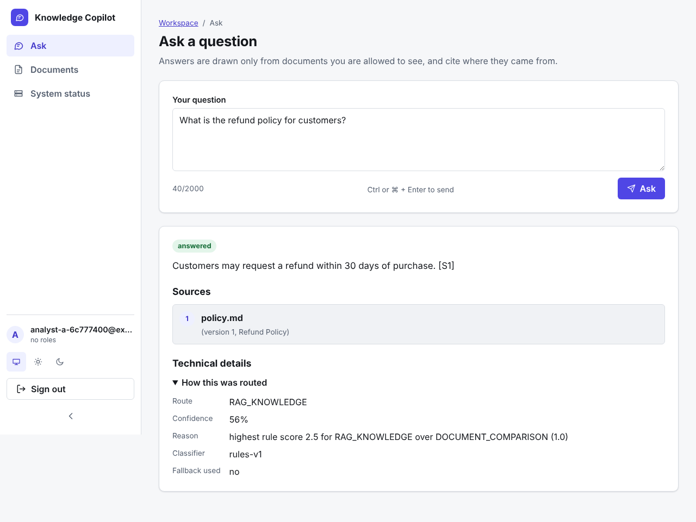

# Frontend (Phase 41)

`apps/web`: a React 18 + TypeScript (strict) single-page app built with Vite, served as static files
by nginx-unprivileged. It talks only to the existing REST API.

## Screens

| Route | Who | What |
|---|---|---|
| `/login` | anyone | organization identifier + email + password (show/hide password); shows the server's message, request id and `Retry-After`; return path is validated (`lib/redirect.ts`) so it can never leave the app |
| `/signup` | anyone | create a **new organization** and become its first `admin` (see "Signup" below); client-side validation mirrors the server, server answers land on the field they concern |
| `/` Ask | signed in | question box (2000 chars, counter, Ctrl/⌘+Enter, Cancel), answer as plain text, sources panel (title, version, page, section), analytics table, collapsed "technical details" (route, confidence, reason, classifier, fallback); abstentions are visibly distinct |
| `/documents` | signed in | list with text-labelled status badges, drag-and-drop or button upload (client pre-checks), live status; polls only while something is processing and stops on its own |
| `/usage` | `admin` | stat cards (tokens today with share of limit, known cost today, limit source), daily limits editor (shows the **server-confirmed** values after saving; asks before removing every limit), usage summary (unpriced events are counted, never shown as `$0`) |
| `/audit` | `admin`, `security_auditor` | paged events (`before_seq`), filter over the loaded events, per-event inspection panel, "Verify integrity" with three distinct outcomes: intact, **failed chain (security incident, first bad seq + reason)**, and "could not be completed" (request failure, says nothing about the chain) |
| `/system` | signed in | exactly what `GET /health/live` and `/health/ready` return (including the 503 report body); no latency, uptime or SLA claims |

## Architecture decisions

- **Same origin.** The edge routes `/api` to the API and everything else to the web container
  (Compose gateway `nginx.conf`, Kubernetes/Helm ingress with `/api` before `/`). The API has no CORS and
  needs none; the client sends `credentials: "omit"` (bearer token only, no ambient cookies).
- **Token handling.** The access token is held in `sessionStorage` (tab-scoped), with a client timer that signs
  out at expiry and on any 401. **Trade-off:** script running in the page could read it. Mitigations: a strict CSP
  (below), no raw-HTML rendering (ESLint rule `no-restricted-syntax` forbids `dangerouslySetInnerHTML`; tests
  prove hostile text renders as text), and the server's short TTL. There are **no refresh tokens or revocation**
  (API gap from Phase 32), so users sign in again after expiry.
- **Roles in the UI are cosmetic.** Claims are decoded only to hide menu items; the server re-checks everything.
- **Errors.** The API's `{error: {code, message, request_id}}` envelope is mapped to a typed `ApiError`; non-JSON
  bodies (gateway pages) are never shown; transient failures (429/503/504/network/timeout) offer retry.
- **No state library, no UI kit**: the app is small, the dependency surface (and supply-chain risk) stays minimal
  (3 runtime dependencies; `axe-core` was added as a *dev-only* dependency for the accessibility tests).

## Security headers (set by `apps/web/nginx`, repeated in every location)

`Content-Security-Policy: default-src 'self'; script-src 'self'; style-src 'self'; img-src 'self' data:; font-src 'self';
connect-src 'self'; object-src 'none'; base-uri 'none'; form-action 'self'; frame-ancestors 'none'` plus `nosniff`,
`X-Frame-Options: DENY`, `Referrer-Policy: no-referrer`, a restrictive `Permissions-Policy`, COOP/CORP same-origin.
No inline script or style exists, so the policy needs no `unsafe-*`. HSTS and TLS are applied by the edge.
Hashed assets are `immutable` for a year; the app shell is `no-cache` so a deploy is picked up at once;
dotfiles and source maps return 404; `/api/*` and `/metrics` reaching this container return 404, never the shell.

## Phase 51: frontend elevation and signup

All pictures are in [`docs/screenshots/`](../screenshots/README.md).

### Design system (no new runtime dependencies)

- **Tokens** in `src/styles.css` (`:root`): colours, status colours, type scale, spacing, radii, shadows. System font
  stack only (the CSP forbids remote fonts). Icons are one inline-SVG set (`components/Icon.tsx`); no emoji.
- **Themes.** Light and dark. Default follows the OS (`prefers-color-scheme`); the sidebar has a System/Light/Dark
  switch. Only the *preference* is stored (`localStorage` key `ekc.theme`, wrapped in try/catch); the session token
  still lives only in tab-scoped `sessionStorage`. The theme is applied before first paint (`initTheme`).
- **Shell.** Collapsible sidebar on desktop (state remembered), off-canvas drawer on phones (Escape or scrim closes
  it, closes after navigation), skip link, focus moves to the page on route change, breadcrumbs and page headers,
  user block with roles. Nav visibility by role is presentation only; the API enforces every check.
- **Components.** Badges (status is always text, never colour alone), cards, skeleton loaders, empty/error states,
  field with hint/error wiring (`aria-describedby`, `aria-invalid`), password field with show/hide, confirmation
  dialog (focus trap, Escape), toasts, responsive tables. No inline styles anywhere (CSP unchanged); progress uses
  `<progress>`.
- **Motion.** Shimmer and drawer transitions are disabled under `prefers-reduced-motion`.

### Signup (the one backend addition)

The original brief for this phase said "no new endpoints"; the request to add a working signup page conflicts with
it, so exactly **one additive endpoint** was added and nothing existing was changed:

`POST /api/v1/auth/signup` `{organization_name, tenant_slug, display_name, email, password}` →
`201 {access_token, token_type, expires_in_seconds, tenant_slug}`

- Creates a **new tenant** and its first user with the `admin` role. It can never add a user to an existing tenant.
- **Off by default in staging/production** (`SIGNUP_ENABLED`, unset = on only in development/test), because an
  internet-facing deployment should not let strangers create tenants unless the operator decides so. When off:
  `403 SIGNUP_DISABLED`.
- Per-IP attempt limit in Redis (`SIGNUP_MAX_PER_IP` per `SIGNUP_WINDOW_SECONDS`) → `429 SIGNUP_THROTTLED` with
  `Retry-After`; same Redis-outage policy as the login throttle.
- Password policy: 10+ characters, at most 72 bytes (bcrypt), a letter and a digit, not containing the email's local
  part → `422 WEAK_PASSWORD`. Duplicate identifier → `409 TENANT_SLUG_TAKEN`. The UI mirrors the rules but the server
  is the authority.
- Audited (`auth.signup`, no password or email in details); added to the reviewed unauthenticated-route allowlist.
- **Not built:** email verification, CAPTCHA, invitations/joining an existing organization, password reset. An
  identifier being taken is observable by design (it is how signup works); the per-IP limit bounds probing.

### API capability matrix (from the source, not from memory)

| Endpoint | Auth | UI status |
|---|---|---|
| `POST /auth/login` | none | used (Login) |
| `POST /auth/signup` | none, setting-gated | used (Signup) |
| `GET /documents`, `POST /documents` (multipart `file`) | any role | used (Documents) |
| `POST /query` | any role | used (Ask); no streaming, no history, no feedback endpoint exists |
| `GET /usage/summary?days=`, `GET/PUT /usage/budget` | `admin` | used (Usage) |
| `GET /audit?limit=&before_seq=`, `GET /audit/verify` | `admin`, `security_auditor` | used (Audit) |
| `GET /health/live`, `GET /health/ready` | none | used (System status) |
| document download / delete / detail, user and role management, password reset, refresh/revoke | **do not exist** | not offered in the UI |

### Verification (this phase)

| Check | Result |
|---|---|
| ESLint `--max-warnings 0`, `tsc --noEmit` strict | run, pass |
| Vitest | 88 tests (33 before): client incl. signup/ready/cancellation, password + slug + safe-redirect rules, signup flows (success, validation, taken identifier, disabled, throttled), shell (mobile menu, collapse, theme), usage (unknown ≠ $0, server-confirmed values, confirmation), audit (three verify outcomes, inspection as text), ask (cancel, shortcut, details), system page |
| Automated accessibility | `axe-core` on login, signup, ask, documents, system, usage: no violations. **Colour contrast is not computed in jsdom**; tokens were chosen for AA contrast but contrast was not machine-verified. No manual screen-reader testing |
| Production build | JS **210.92 kB (67.80 kB gzip)** vs 183.42 kB (59.69 kB) before; CSS **15.27 kB (3.93 kB gzip)** vs 2.4 kB. The increase is the signup flow, shell, dialogs, toasts and system page; no runtime dependency was added |
| Backend signup tests (`tests/integration/test_signup.py`) | success + working token, login afterwards, password never stored, duplicate identifier, same email in two organizations, weak passwords, invalid fields, disabled, throttle with `Retry-After`, environment defaults |
| Browser E2E (real Chromium → gateway nginx → web nginx → API → Postgres/Redis) | all pre-existing flows pass against the new UI, plus signup, taken identifier / weak password, phone viewport (no horizontal scroll, drawer), dark theme persistence, no CSP violations or console errors |

Stand-ins in the E2E stack are unchanged: loopback Kafka, in-memory object store, extractive answerer (the answers in
the screenshots are extractive excerpts, **not** real-LLM output), deterministic embeddings.

## What was verified (Phase 41, original)

| Check | Result |
|---|---|
| ESLint (type-aware, `strictTypeChecked`, zero warnings), `tsc --noEmit` strict | run, pass |
| Unit/component tests (Vitest + Testing Library, 33 tests): API client, session handling, upload rules, login, routing and role gating, query rendering incl. XSS payload, document polling and rejection of bad files, audit verification and paging | run, pass |
| Production build | run: 183 KB JS (59.6 KB gzip), 2.4 KB CSS (measured) |
| The shipped nginx config against real nginx (`tests/integration/test_web_nginx.py`, 5 tests): CSP, caching, SPA fallback, `/api` and `/metrics` 404, dotfiles | run, pass |
| Compose gateway routing `/` to web and `/api` to the API (`test_gateway_nginx.py`), post-deploy smoke test through it | run, pass (web upstream stood in by a stub server) |
| Rendered in headless Chromium (login redirect, no console errors, screenshot reviewed) | run once, login page only |
| `npm audit --omit=dev` | **0 high**; 2 moderate remain (see gaps). A real finding was fixed: `react-router-dom` 6.26.2 had high-severity advisories, upgraded to 6.30.6 |
| Kustomize + kubeconform for the new Deployment/Service/PDB/NetworkPolicy/Ingress paths; policy tests | run, pass |
| `docker build` of `apps/web/Dockerfile` | **NOT RUN** (Docker Hub unreachable); hadolint passes |
| Helm rendering of the new templates | **NOT RUN** (no helm binary); structural tests pass |
| Browser E2E against the real API, cross-browser, mobile devices, screen reader, axe/Lighthouse, load | **NOT RUN / NOT MEASURED** (E2E is Phase 42) |

Accessibility is designed in (labels on every field, `aria-live` results, `role=alert` errors, skip link, visible
focus, table headers with scope, colour-scheme support, responsive tables) but has **not been audited with
assistive technology or automated tooling**.

## Delivery

- Image `ekc-web` (own Dockerfile, non-root UID 101, read-only root filesystem, `/tmp` tmpfs, no secrets, no
  config). CI builds, scans (Trivy) and **signs it by digest** next to the API image; the deploy workflow
  verifies both signatures and rolls out both (API + web) with the same staged order and rollback.
- Kubernetes: `ekc-web` Deployment (2 replicas, anti-affinity + zone spread, PDB), Service, NetworkPolicy
  allowing only the ingress controller on 8080; Helm chart has the same objects (`web.image.*` required).
- Compose: `web` service behind the gateway (loopback-bound by default).
- Local development: `cd apps/web && npm ci && npm run dev` (proxies `/api` to an API on 127.0.0.1:8000).

## Known gaps

- No refresh tokens, revocation or MFA (API); sessionStorage token exposure to XSS (mitigated, not eliminated).
- **2 moderate `npm audit` advisories** in `react-router` 6.x: open redirect via backslash in `<Link>`/`useNavigate`
  and SSR hydration deserialisation. The app navigates only to paths it set itself (router state), never to
  user-supplied URLs, and does no SSR, so exposure is low; the fix is a v7 migration (breaking) and is not done.
- The API offers no document download/delete/detail endpoints, so there is no document viewer, no clickable
  citations and no deletion UI. No streaming answers. No i18n. Admin screens do not edit users or roles (no API).
- Behind the Compose gateway, unknown paths such as `/docs` return the app shell (200); the smoke test accounts
  for this by looking for the API documentation itself rather than a status code.
- No automated visual regression. Browser E2E exists (Phase 42 and 51); cross-browser and real-device runs were not done.
- Upload progress is indeterminate: `fetch` cannot report upload progress, and the UI does not pretend otherwise.
- The audit filter only searches events already loaded; there is no server-side search endpoint.
- Windows/other browsers, Docker image build, Helm and Kubernetes were not exercised for this phase.
